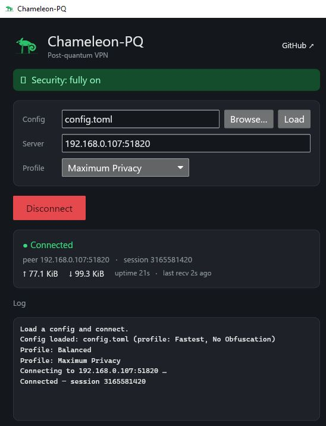
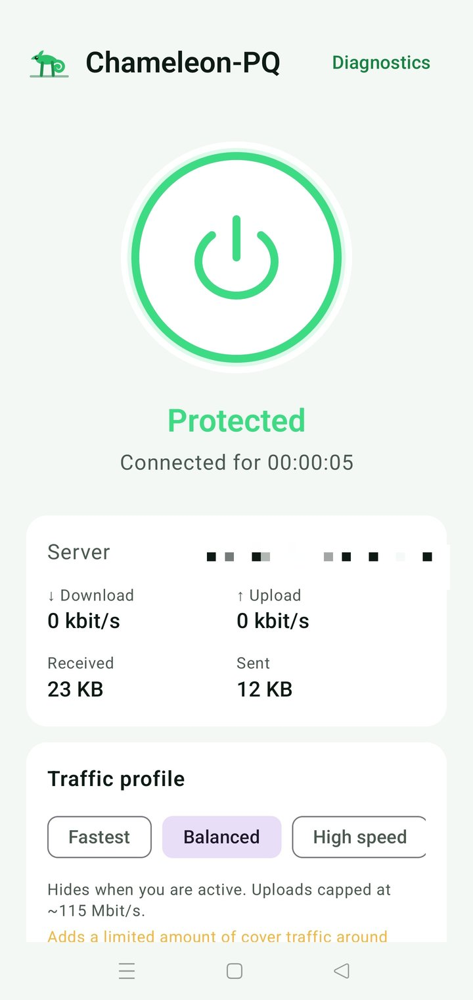
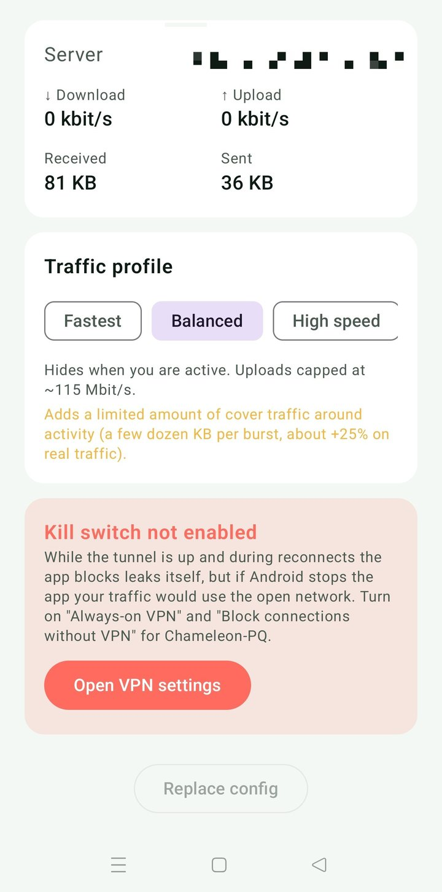

<p align="center">
  
</p>

# Chameleon-PQ

[](https://github.com/btdt1983/chameleon-pq/actions/workflows/ci.yml)
[](https://crates.io/crates/chameleon-pq)
[](https://github.com/btdt1983/chameleon-pq/releases)
[](LICENSE)

*[🇬🇧 English](README.md) | 🇩🇪 Deutsch*

Experimentelles hybrides Post-Quanten-VPN, geschrieben in Rust. Kombiniert
ML-KEM-768 (KEM) mit X25519 für den Schlüsselaustausch und eine hybride
Ed25519 + ML-DSA-65 (FIPS 204)-Signatur für die Peer-Authentifizierung,
über UDP mit einer TUN-Schnittstelle unter Linux/macOS/Windows.

## Warum post-quantum?

Fast die gesamte heute genutzte Verschlüsselung — das Schloss-Symbol bei
Websites, VPNs, Messenger-Apps — beruht auf Mathematik (RSA, elliptische Kurven),
die ein ausreichend großer **Quantencomputer** brechen könnte. Solche Maschinen
gibt es noch nicht, aber sie werden gebaut.

Der Haken ist **„jetzt sammeln, später entschlüsseln"**: Ein Angreifer kann
Ihren verschlüsselten Datenverkehr *heute* aufzeichnen, speichern und einfach
warten — um ihn Jahre später zu entschlüsseln, sobald ein Quantencomputer
verfügbar ist. Alles, was lange geheim bleiben muss, ist also schon jetzt
gefährdet, noch bevor es Quantencomputer überhaupt gibt.

Chameleon-PQ ist für diese Welt gebaut. Es nutzt ein **hybrides** Design, das die
heute bewährte Verschlüsselung (X25519) mit einem neuen **quantenresistenten**
Verfahren (ML-KEM-768, von der NIST standardisiert) kombiniert. Ihr
Datenverkehr bleibt geschützt, solange *eines von beiden* hält — so gewinnen Sie
Schutz gegen die Quantencomputer von morgen, ohne die heute vertraute Sicherheit
aufzugeben.

## ⚠️ Sicherheitsstatus: experimentell — Nutzung auf eigenes Risiko

Chameleon-PQ ist **experimentell** und wurde **nicht offiziell und unabhängig
auditiert**. Jedes selbst entwickelte kryptografische Protokoll sollte mit
Vorsicht behandelt werden, bis qualifizierte Fachleute es geprüft haben — die
**Nutzung erfolgt daher auf eigenes Risiko**. Es eignet sich hervorragend als
Lernprojekt, als Architekturreferenz oder als Ausgangspunkt für ein
ordnungsgemäß auditiertes System — nur noch nicht als sofort einsetzbares
Produktiv-VPN.

Bekannte Einschränkungen des Geltungsbereichs:
- Es wurde kein externes Sicherheitsaudit durchgeführt – das bleibt der mit
  Abstand wichtigste Vorbehalt für jedes selbst entwickelte Protokoll
- Der **Datenpfad**, die **Handshake-Hülle** UND jetzt das **Paket-Timing** sind
  verschleiert – jedes Datagramm sieht aus wie Zufallsbytes, und optionales
  Traffic-Shaping (`[traffic]`, standardmäßig an im **Adaptive**-Modus;
  **CBR** für volle Constant-Rate verfügbar) sendet auf einem festen Takt und
  füllt leere Slots mit Cover-Paketen, sodass Bursts und Aktiv-vs-Idle in einem
  gleichmäßigen Strom aufgehen. Rest (dokumentiert, keine *vollständige*
  Resistenz-Behauptung): Existenz und Gesamtdauer der Tunnel sind einer festen
  Site-to-Site-Verbindung inhärent, der **initiale** Handshake-Burst liegt vor
  dem Pacer, und der Handshake-Schlüssel ist standardmäßig pubkey-abgeleitet
  (`[obfuscation].psk_hex` schließt das). Shaping kostet Bandbreite/Latenz – die
  konfigurierte Rate ist zugleich die Untergrenze
  und das Durchsatz-Limit
- ML-DSA ist für die Authentifizierung integriert, der Schlüsselaustausch
  kombiniert aber weiterhin ML-KEM-768 mit X25519 (kein zweites PQ-KEM)

## Was funktioniert

- Hybrider Post-Quanten-Handshake (ML-KEM-768 + X25519, beide ephemer → PFS)
- Gegenseitige Authentifizierung: 3-Nachrichten-Handshake (2-RTT), bei dem
  beide Peers das Transcript signieren; der Responder gewährt kein
  Vertrauen, bis das Confirm des Initiators verifiziert ist
- Return-Routability-Cookie (WireGuard-Stil, stateless): der Responder macht
  keine teure ML-KEM/DH/ML-DSA-Arbeit, bis der Initiator ein an seine
  Quelladresse gebundenes Cookie zurückspiegelt — eine gespoofte/unverifizierte
  Quelle kann so weder den teuren Handshake noch eine große reflektierte Antwort
  auslösen. Die CookieChallenge ist eine vollwertige verschleierte Nachricht und
  fällt daher nicht auf
- Hybride Ed25519 + ML-DSA-65 (FIPS 204)-Transcript-Signierung zur
  Peer-Authentifizierung (vorab geteilte Identitäten) – die Signatur hält,
  solange *eines* der beiden Verfahren ungebrochen ist; fällt auf
  Ed25519-only zurück, wenn keine ML-DSA-Schlüssel konfiguriert sind
- Austauschbares AEAD für den Datenpfad: ChaCha20-Poly1305 (über `ring`,
  konstantzeitfähig, der universelle Standard) und AEGIS-256X2
  (CAESAR-Gewinner, schneller auf CPUs mit AES-Hardware), gewählt durch
  hardwarebewusste Aushandlung, wobei die Wahl im Transcript gegen Downgrade
  gebunden ist
- Verschleierter Datenpfad (QUIC-artiger Header-Schutz): jedes Daten-Datagramm
  sieht aus wie gleichverteilte Zufallsbytes – kein statisches Typ-Byte, keine
  sichtbare session_id, kein sichtbarer monotoner Zähler. Der Header wird mit
  einem Keystream maskiert, der (per HMAC-SHA256) aus einer Probe des AEAD-Tags
  abgeleitet wird, und der echte Frame-Typ steckt *innerhalb* der
  verschlüsselten Payload, sodass Keepalives nicht von Daten zu unterscheiden
  sind. Konfigurierbares Längen-Padding (off / bucketed / full) verbirgt die
  Paketgrößen. Die Header-Integrität kommt weiterhin vom AEAD (der
  zurückgewonnene Header ist die Associated Data) – die Maske dient nur der
  Vertraulichkeit
- Verschleierte Handshake-Hülle (statischer Schlüssel, `hsobf.rs`): die
  Handshake-Nachricht wird in einer ChaCha20-Poly1305-Schicht verpackt (Schlüssel
  aus den vorab geteilten Identitäten oder einem optionalen `psk_hex`) und in
  größen-jitterte Fragmente mit maskiertem Header aufgeteilt – der Handshake-Burst
  zeigt kein konstantes Typ-Byte und keine feste Fragment-Struktur mehr. Die echte
  Handshake-Krypto bleibt unverändert; reine äußere Verschleierung (keine Forward
  Secrecy auf der Verschleierungsschicht)
- Timing-/Cover-Traffic-Shaping (`pacer.rs`, `[traffic]`, standardmäßig an im
  Adaptive-Modus): Pakete gehen auf einem festen Takt raus und leere Slots werden
  mit Cover-(Dummy-)Paketen gefüllt, die der Empfänger stillschweigend verwirft,
  sodass Burst- und Aktiv-vs-Idle-Muster verborgen werden. Cover-Pakete sind
  gewöhnliche obf-Datagramme mit einem verschlüsselten `Padding`-Inner-Type,
  konstante Größe unter `Full`-Padding, also nicht von echten Daten zu
  unterscheiden. Adaptive (Standard) pact während Aktivität + Cooldown und wird
  in Ruhe still (keine Bandbreite idle); **CBR** sendet konstant für die stärkste
  Verbergung zu konstanten Kosten. Keine Wire-/Proto-Änderung – ein älterer Peer
  verwirft Cover-Pakete gefahrlos
- Richtungsabhängige Schlüssel; Replay-Schutz per Sliding-Window mit 2048
  Einträgen
- Rekey mit Anti-Storm-Sperre, Wiederholung bei Paketverlust und
  Überlappung von aktueller und vorheriger Session, sodass laufender
  Datenverkehr den Wechsel übersteht
- Fragment-Reassemblierung mit DoS-resistentem Entfernen veralteter
  Teilstücke
- Keepalive / Erkennung toter Peers
- Plattformübergreifendes TUN: Linux, macOS, Windows (Wintun)
- **Desktop-GUI-Client** (`chameleon-gui`, reines Rust mit [iced]): eine
  Windows-App im Dark-Theme — Konfiguration auswählen, verbinden / trennen,
  Live-Status, ein übersichtlicher Traffic-Profil-Auswähler und ein integriertes
  Log, ohne Konsolenfenster (siehe [Desktop-Client](#desktop-client-gui) unten)
- Performance (keine Wire-Änderung): das Datenpfad-AEAD wird beim Start per
  Kurz-Benchmark automatisch gewählt (AEGIS-256X2 wo am schnellsten, sonst
  ChaCha20 — z. B. wenn AEGIS auf Software-AES zurückfällt); die UDP-I/O ist
  gebündelt mit GSO/GRO (via `quinn-udp`, Per-Paket-Fallback) — ein Microbench
  hebt den Sendepfad von ~0,18 auf ~9,6 Mpps; und Seal/Open laufen PARALLEL über
  alle Cores (rayon, `[engine].workers`), gemessen ~4,5× (seal) / ~13× (open) auf
  einer 12-Thread-Maschine. Hinweis: der parallele Pfad hilft im **schnellen
  Modus** (`traffic.enabled = false`); mit Timing-Shaping an (Standard) begrenzt
  die Rate den Durchsatz — Geschwindigkeit und Timing-Verschleierung sind
  gegensätzliche Dimensionen, zwischen denen man wählt
- 84 Tests, die Handshake (inkl. gegenseitiger Auth + Fragmentierung),
  hybride ML-DSA-Auth (und dass ein falscher PQ-Schlüssel scheitert, selbst
  wenn Ed25519 passt), AEAD-Aushandlung und AEGIS-Sessions, Associated-Data-
  Header-Bindung, Datenpfad, Replay (inkl. weitem Reordering), MITM (beide
  Richtungen), Rekey, Prune-Verhalten, den verschleierten Datenpfad (Round-Trip
  mit beiden Ciphern, Manipulations-Ablehnung, Trial-Demux über aktuelle +
  vorherige Session, Längen-Padding, leere Keepalives) und die verschleierte
  Handshake-Hülle (symmetrische Schlüsselableitung, Wrap-then-Fragment-Round-Trip
  mit Jitter, vollständiger gegenseitiger Handshake, Ablehnung falscher
  Schlüssel/Rauschen, Reassembler-Cap + Prune), Timing-/Cover-Traffic (die
  CBR-/Adaptive-/Cooldown-Logik des reinen Pacers, dass ein Cover-Paket als
  `Padding` zurückkommt und unter `Full`-Padding gleich lang + Header-verschieden
  ist), parallele Krypto (parallel versiegelte Pakete entschlüsseln alle mit
  eindeutigen Countern, und `decrypt_batch_par` trennt Daten von Rauschen),
  rollen-getrennte Handshake-Signaturen (eine reflektierte Responder-Signatur
  wird als Confirm abgelehnt, selbst bei geteiltem Identitätsschlüssel), den
  bounded UDP-Handshake (gegenseitiger Abschluss über echte Sockets + sauberer
  Timeout, wenn kein Responder antwortet), Identitätsbindung (symmetrisch,
  peer-abhängig), die Ablehnung von low-order/all-zero-X25519-Punkten und das
  Return-Routability-Cookie (deterministisch + eingabeabhängig, und eine Init
  ohne Cookie wird mit einer CookieChallenge statt einer teuren Response
  beantwortet) abdecken
- Fuzzing der Parser für Angreifer-Eingaben (Frame- + Handshake-Decode, die
  Verschleierungs-Parser von Datenpfad und Handshake, der Reassembler und der
  Inbound-Entschlüsselungspfad): eine stabile Random-/Edge-Case-Harness läuft mit
  `cargo test` (`tests/fuzz_parsers.rs`), dazu coverage-guided `cargo-fuzz`-Targets
  in `fuzz/` (Nightly; wöchentlicher CI-Job). ~18 Mio. Ausführungen fanden keinen
  Panic
- End-to-End-Tunnel-Test (`tests/e2e_tunnel.rs`): die **echten** Tunnel-Loops
  (`tunnel_loops::run_tunnel_loops`) laufen auf beiden Seiten über Loopback-UDP
  mit einem Mock-TUN, und Klartext fließt in beide Richtungen durch den
  vollständigen Handshake (inkl. L-4-Cookie-Round-Trip) → Seal → GSO-Send →
  GRO-Recv → Decrypt → TUN-Pfad

## Download

Vorgefertigte Binaries hängen an jedem [Release](../../releases/latest):

- **Windows** — `chameleon-pq-<version>-windows-x64.zip`: ein eigenständiges Bundle
  mit der Desktop-GUI (`chameleon-gui.exe`), dem CLI (`chameleon-pq.exe`), der
  Microsoft-signierten `wintun.dll`, einer Beispielkonfiguration und Hinweisen.
  Entpacken und starten — sonst nichts zu installieren.
- **Android** — [`ChameleonPQ.apk`](../../releases/latest/download/ChameleonPQ.apk)
  (Android 14+, arm64): siehe [Android-App](#android-app).
- **Linux-Server** — `chameleon-pq_<Version>-1_amd64.deb` und
  `chameleon-pq-<Version>-1.x86_64.rpm`, gebaut für glibc ≥ 2.31 (getestet auf
  AlmaLinux 9.8 und Ubuntu 24.04): siehe [Server installieren](#server-installieren-linux).
- **Linux** — `chameleon-pq-linux-x86_64` (CLI, gleicher glibc-≥-2.31-Build).
- **crates.io** — `cargo install chameleon-pq` (CLI).

## Server installieren (Linux)

Paket installieren, den Rest erledigt `setup`:

```sh
sudo apt install ./chameleon-pq_*_amd64.deb      # Debian / Ubuntu
sudo dnf install ./chameleon-pq-*.x86_64.rpm     # AlmaLinux / RHEL / Fedora

sudo chameleon-pq setup
```

`setup` fragt nach der öffentlichen `ip:port` des Servers und zeigt jeden Schritt,
bevor er ausgeführt wird (`--yes` überspringt die Rückfragen, `--dry-run` zeigt nur
den Plan):

1. erzeugt die Server-Schlüssel (Ed25519 + ML-DSA-65) und eine dazu passende
   **Client-Konfiguration** mit gemeinsamem Obfuskations-PSK
2. aktiviert IPv4-Forwarding (dauerhaft, `/etc/sysctl.d`)
3. öffnet den UDP-Port und richtet NAT ein — in **firewalld** oder **ufw**, falls
   aktiv, sonst in einer eigenen nftables-Tabelle (`inet chameleon_pq`); zusätzlich
   ein TCP-MSS-Clamp auf dem Tunnel
4. aktiviert und startet `chameleon-pq.service`

Ohne Paketmanager: `sudo install -m 0755 chameleon-pq-linux-x86_64
/usr/local/bin/chameleon-pq && sudo chameleon-pq setup` funktioniert ebenfalls —
`setup` schreibt die systemd-Units dann selbst.

Wiederholbar: erledigte Schritte werden übersprungen, eine vorhandene
Server-Konfiguration bleibt erhalten, außer mit `--force` (das macht alle
Client-Konfigurationen ungültig; die alte Datei wird gesichert). Die erzeugte
Client-Konfiguration zum Client kopieren und **vom Server löschen**.

Der Dienst läuft als unprivilegierter Benutzer `chameleon-pq` mit nur
`CAP_NET_ADMIN` und systemd-Sandbox. Die Konfiguration liegt in `/etc/chameleon-pq`
(`server-config.toml`, Modus 0640, `root:chameleon-pq`). Beim Entfernen des Pakets
bleibt sie erhalten, `apt purge` löscht sie. Eine Server-Konfiguration vertraut genau
einem Client. Mit firewalld liegt die Tunnel-Schnittstelle in der Zone `trusted`;
der VPN-Peer erreicht dann jeden auf dem Server lauschenden Dienst.

## Desktop-Client (GUI)

<p align="center">
  
</p>

Lieber per Klick verbinden statt über die Kommandozeile? Das Windows-Release enthält
einen nativen Desktop-Client, **chameleon-gui**, in reinem Rust mit [iced] gebaut:

- ein Dark-Theme mit dem Chamäleon-Logo und passendem Taskleisten-Symbol;
- `config.toml` auswählen, verbinden / trennen und den Live-Status verfolgen;
- ein übersichtlicher Traffic-Profil-Auswähler (Maximum Privacy · Balanced · High
  Speed · Fastest) und ein integriertes Log — ohne Konsolenfenster im Hintergrund;
- ein Link direkt zu diesem Repository in der Kopfzeile.

Er ist im eigenständigen Windows-Bundle oben enthalten und baut auch aus dem
Quellcode unter Linux/macOS mit `cargo build --release --manifest-path gui/Cargo.toml`.

[iced]: https://iced.rs

## Android-App

<p align="center">
  
  &nbsp;&nbsp;
  
</p>

Das Release enthält auch einen Android-Client,
[`ChameleonPQ.apk`](../../releases/latest/download/ChameleonPQ.apk):

- ein großer Ein/Aus-Knopf, Live-Geschwindigkeit (Down/Up), Verbindungsdauer und der
  Server, mit dem verbunden ist;
- eine **Traffic-Profil-Auswahl** (Fastest · Balanced · High speed · Max privacy), die
  live umschaltet, ohne neu zu verbinden. Der Server folgt der Wahl des Clients
  (`[traffic] follow_client_profile`, standardmäßig an), sodass beide Richtungen gleich
  geformt werden — die Auswahl zeigt, was jedes Profil kostet;
- die Sitzung bleibt bei WLAN ↔ Mobilfunk-Wechseln bestehen (der Server folgt dem
  Handy an die neue Adresse), und fällt der Tunnel doch aus, verbindet die App neu,
  **mit gesperrtem Datenverkehr**, statt ins offene Netz zu lecken;
- ein Kill-Switch-Hinweis: Android lässt nur *dich* „Always-on VPN“ und „Verbindungen
  ohne VPN blockieren“ einschalten; die App zeigt, ob es aktiv ist, und verlinkt auf
  diese Einstellungsseite;
- ein Diagnose-Log auf dem Gerät (mit Kopieren-Knopf).

Installation: die `.apk` auf dem Handy öffnen („Installation aus unbekannten Quellen“
für die öffnende App erlauben), dann deine `client-config.toml` importieren (aus
`chameleon-pq init` oder `chameleon-pq setup`). Die Konfiguration enthält deine privaten
Schlüssel und bleibt im privaten App-Speicher; sie ist nicht in der APK, und das
Android-Backup ist aus.

Benötigt **Android 14 oder neuer auf einem 64-Bit-ARM-Handy** und wurde bisher nur auf
einem Gerät (Android 14) getestet. Die APK wird lokal vom Maintainer gebaut und
signiert, nicht von der CI; ihre SHA-256 steht in den Release-Notes zum Prüfen des
Downloads.

## Build

Erfordert eine aktuelle Rust-Toolchain (1.80+; Installation über
[rustup](https://rustup.rs/)).

```bash
cargo build --release
cargo test
```

Oder von crates.io installieren:

```bash
cargo install chameleon-pq
```

## Schnellstart

```bash
# 1. Schlüsselpaare auf beiden Knoten erzeugen
./target/release/chameleon-pq keygen

# 2. config.example.toml nach config.toml kopieren, den eigenen Seed und den
#    öffentlichen Schlüssel des Peers eintragen (out-of-band austauschen)

# 3. Validieren
./target/release/chameleon-pq --config config.toml check

# 4. Als Server starten (benötigt CAP_NET_ADMIN unter Linux für TUN)
sudo ./target/release/chameleon-pq --config config.toml server

# 5. Als Client starten
sudo ./target/release/chameleon-pq --config config.toml client \
    --server 1.2.3.4:51820
```

Unter Windows benötigen Sie zusätzlich `wintun.dll` von
<https://www.wintun.net> neben der Binärdatei.

## Architektur

- `crypto.rs` – `Authenticator`-Trait mit `Ed25519Auth` (über `ring`) und
  `MlDsaAuth` (ML-DSA-65 über `pqcrypto-mldsa`), kombiniert durch
  `HybridAuth` (alle Legs müssen verifizieren); Transcript-Hash, HKDF
- `aead.rs` – austauschbares AEAD für den Datenpfad: `ChaCha20-Poly1305`
  und `AEGIS-256X2` hinter einem Trait (jetzt mit Associated-Data-Support),
  ein Start-Microbenchmark wählt automatisch die schnellere Chiffre für die
  Maschine, und die Wahl ist downgrade-sicher (im Handshake-Transcript gebunden)
- `session.rs` – richtungsabhängige AEAD-Schlüssel, Nonce-Verwaltung,
  Header-Bindung per AAD, Sliding-Window-Replay, `SessionManager` mit Rekey
- `tunnel.rs` – 8192-Byte-Handshake (einzelner KEM-Slot, mit Rauschen
  aufgefüllt; dimensioniert für die hybride PQ-Signatur),
  Fragmentierung/Reassemblierung, Zustandsmaschine mit Transcript-Signierung
- `frame.rs` – MTU-sicherer, Magic-freier Frame (<1280 B) für die
  Handshake-Hülle und den Legacy-Datenpfad (bei ausgeschalteter Verschleierung)
- `obf.rs` – Verschleierung des Datenpfads: QUIC-artiger Header-Schutz
  (13-Byte-Header maskiert mit einem Keystream aus einer AEAD-Tag-Probe),
  Inner-Type-Framing (echter Frame-Typ verschlüsselt in der Payload) und
  konfigurierbares Längen-Padding
- `hsobf.rs` – Verschleierung der Handshake-Hülle: ein statischer Schlüssel (aus
  den vorab geteilten Ed25519-Pubkeys oder einem optionalen PSK) verpackt die
  ganze Handshake-Nachricht in ChaCha20-Poly1305 und teilt sie in größen-jitterte
  Fragmente mit maskiertem Header (`derive_hs_obf_key` / `seal_and_fragment` /
  `unmask_fragment` / `open`)
- `pacer.rs` – reiner (tokio-freier) Constant-Rate-Scheduler für
  Timing-/Cover-Traffic-Shaping: `Pacer::next_emit` entscheidet pro Slot, ob ein
  echtes Paket, ein Cover-Paket oder nichts gesendet wird (`ShapeMode`
  CBR/Adaptive); die async-Schleife in `main.rs` treibt ihn an
- `engine.rs` – CPU-Verschlüsselungs-Engine: Batch-Seal/Open, **parallel über
  alle Cores** via rayon (`encrypt_batch_par` / `decrypt_batch_par`); die
  Outbound-Schleife (`tunnel_loops.rs`) reserviert vorab einen zusammenhängenden
  AEAD-Zählerbereich pro Batch und versiegelt ihn auf rayons warmem Thread-Pool
  (`rayon::spawn`) – nach WireGuard-go-Vorbild, statt einer Batch-Größen-Schwelle;
  konstantzeitfähig, geringe Latenz, kein GPU-Pfad (siehe DESIGN.md §11–§12 zur
  Begründung)
- `net.rs` – UDP-Schleifen; klare Ein-/Ausgangspunkte zur TUN-Schicht
- `udp.rs` – gebündelte UDP-I/O (GSO beim Senden, GRO beim Empfangen) via
  `quinn-udp`, mit Per-Paket-Fallback auf älteren Kernels / Nicht-Linux; das
  einzige Modul, das die Dependency berührt (`batch_send` / `batch_recv` /
  `group_equal_sized`)
- `rekey.rs` – Rekey-Treiber, der das Problem des gemeinsam genutzten
  Sockets löst (die Inbound-Schleife ist der einzige Socket-Leser; der
  Rekey-Treiber empfängt über einen Channel)
- `tun_iface.rs` – plattformübergreifendes TUN mit Mock für Tests
- `config.rs` – TOML-Loader, CLI

## Lizenz

Apache 2.0 – siehe [LICENSE](LICENSE).
